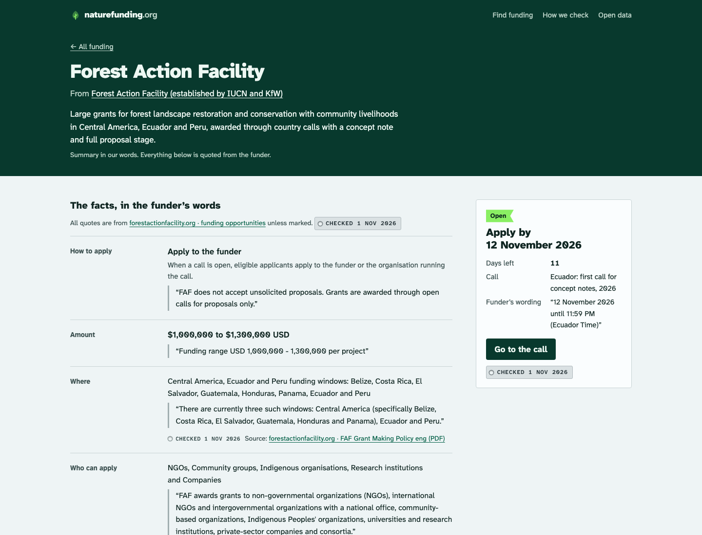

## Decision

The finder and the apply box show "2 Nov 2026", with the funder's own words quoted under it in small type: “Monday, 2 November 2026 (11:59 p.m. Atlantic Standard Time)”. The brief said "deadline as the funder wrote it". The funder's wording stays on screen, but it isn't the main line.

## Why

With real data, funder wording runs to four lines in a narrow column and comes in several languages ("até o dia 09 de novembro de 2026"). One date format makes the soonest-first list scannable. Nothing is inferred: the date is the one the data thread read from the same quote.

## Where

- src/components/Listing.astro
- src/pages/p/[id].astro
