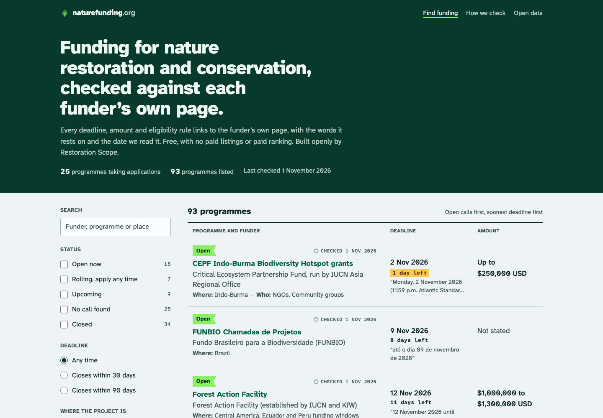
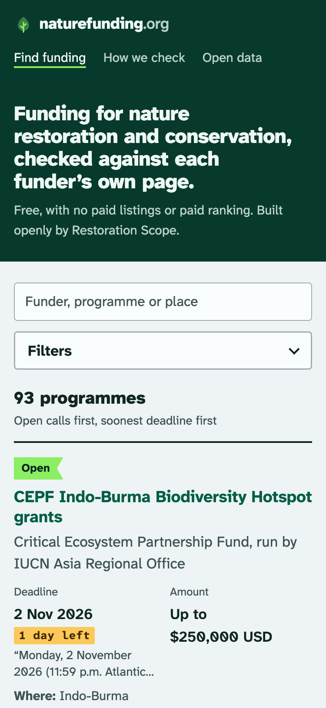
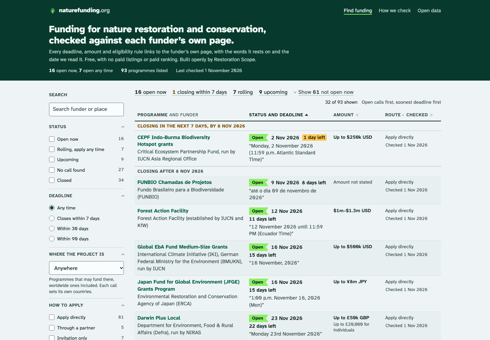
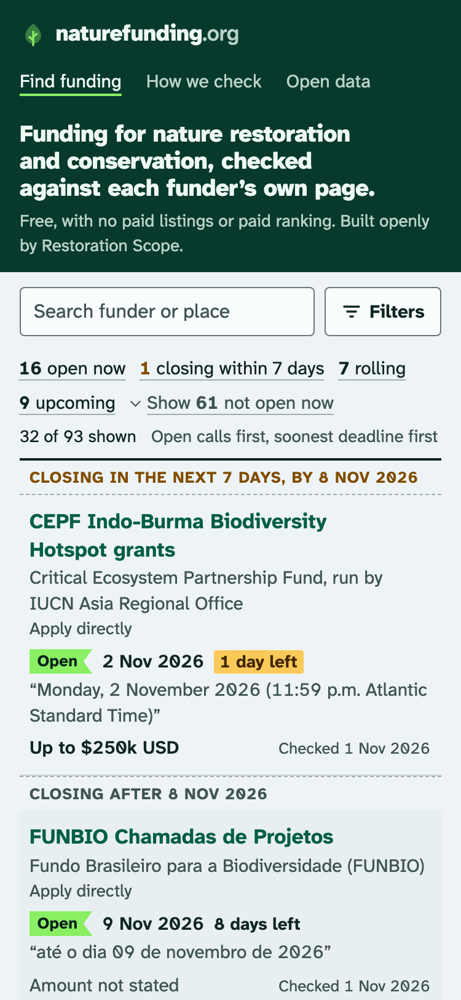
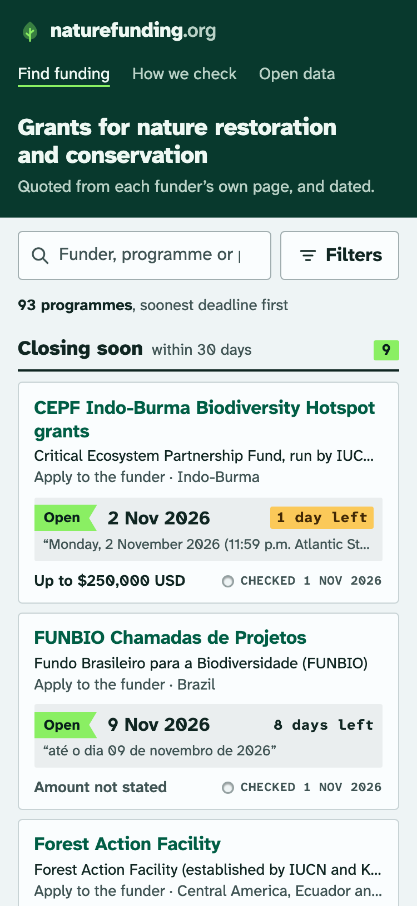
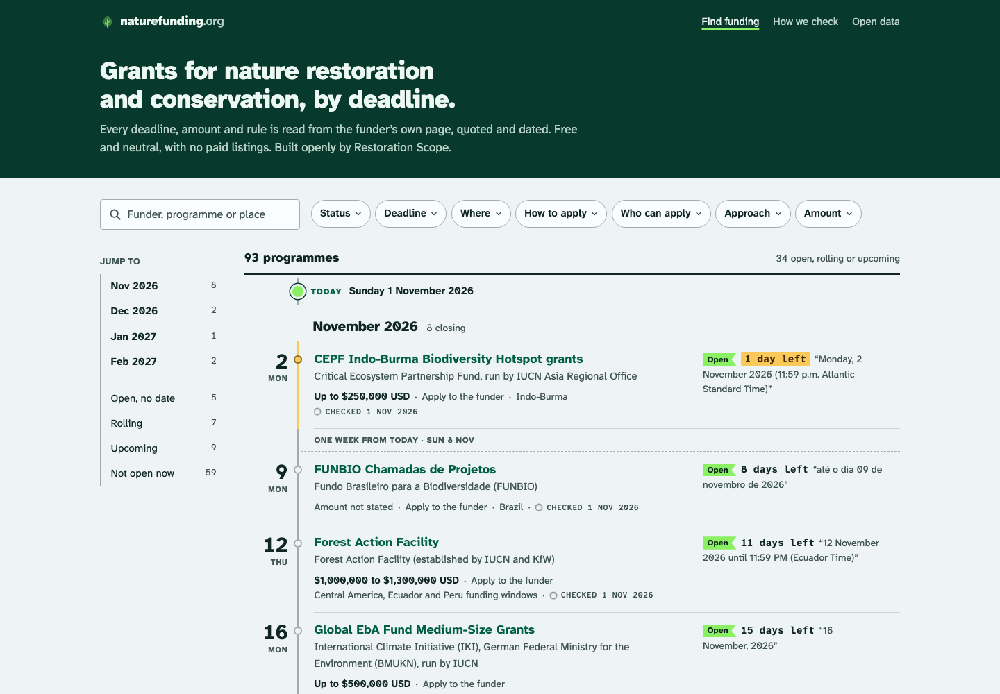

## Decision

The home finder is now a table:
- Desktop:
  - Columns: programme and funder, status and deadline, amount, route and Checked stamp.
  - Deadline, amount and checked date sort from the column headers, and the sort goes in the URL.
  - A summary line ("16 open now · 1 closing within 7 days · 7 rolling · 9 upcoming · Show 61 not open now") doubles as quick filters.
  - Divider lines split calls closing in the next 7 days from those closing later.
- Phone:
  - Each grant is a compact row: the name; the funder in full, with the route on the next line; the status tape with our date and days left; the funder's own words on the deadline (or, with no date, on when to apply); then the amount and the stamp.
  - Filters open in a sheet with a fixed "Show N results" bar.
- Every "Checked" stamp on the site, not only the finder's, is now in sentence case ("Checked 1 Nov 2026") instead of uppercase mono, so the stamp looks the same wherever it appears.
- "Not open now" programmes fold away, with a toggle at the top and a "Show all" button at the end of the list.

Before:

After:

## Why

Three Opus 5.5 subagents each built a different direction behind temporary routes: (a) cards, (b) a dense table and (c) a deadline timeline. One fresh critic then scored all three and the old finder on the same screenshots (usability / readability / aesthetics):

| Version | Desktop | Phone |
|---|---|---|
| Old finder | 6 / 7 / 7 | 5 / 7 / 6 |
| a: cards | 7 / 7 / 7 | 8 / 8 / 7 |
| b: table | 9 / 8 / 7 | 7 / 6 / 6 |
| c: timeline | 7 / 8 / 8 | 6 / 7 / 7 |

The table is the only version that lets someone scan about 13 grants per desktop screen, sort them and filter from the counts. Its weak spot was the phone row. That row now borrows the cards version's order, and the status reads as a word, not colour alone. It also borrows the end-of-list "Show all" button from the cards version, and the next-7-days line from the timeline.

The catch: on phones, the hero still takes about 440px, so the first screen shows about two and a half grants. Later screens show about four, where the old finder showed half of one. The old finder also left out the route on direct rows: 81 rows had no "Apply to the funder".

Alternatives, for reference:

## Where

- src/pages/index.astro
- src/components/FinderRow.astro
- src/lib/finder.ts
- src/lib/table.ts
- src/styles/global.css (the stamp style)
