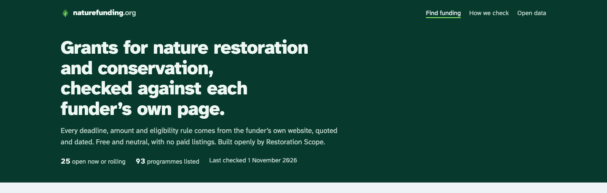

## Decision

Headline: "Grants for nature restoration and conservation, checked against each funder’s own page." Lede: "Every deadline, amount and eligibility rule comes from the funder’s own website, quoted and dated. Free and neutral, with no paid listings. Built openly by Restoration Scope." Phones drop the first sentence of the lede (the headline already says it) and the stats line, so the first grant shows sooner. The stats line reads "25 open now or rolling", matching the finder's filters, which count Open now and Rolling separately. The OG image repeats the headline.

## Why

It says what this is, why to trust it, and who builds it in one screen, which the brief asked for. I passed on a benefit-led line ("Find funding for your project"), because every directory says that and trust is what sets this one apart.

## Where

- src/pages/index.astro
- public/og.png
