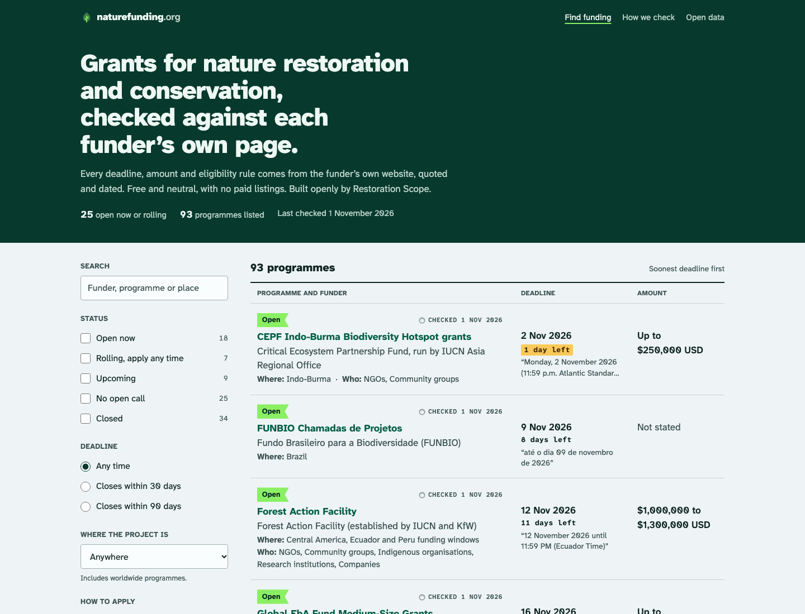
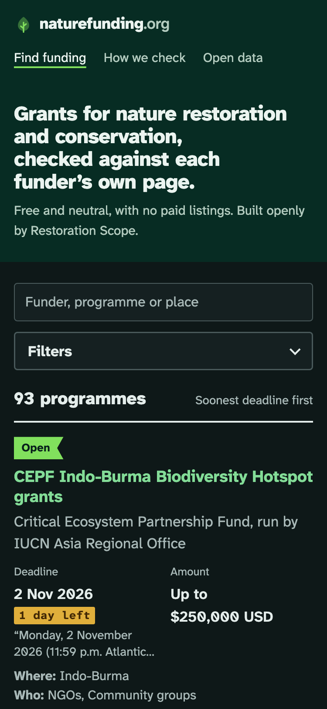
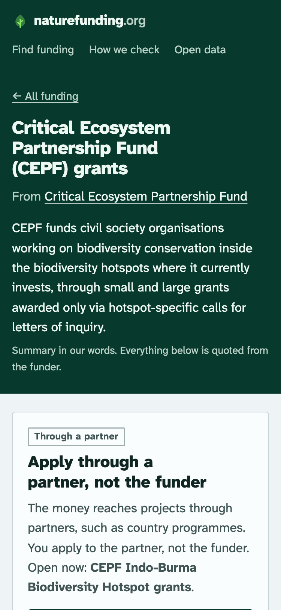
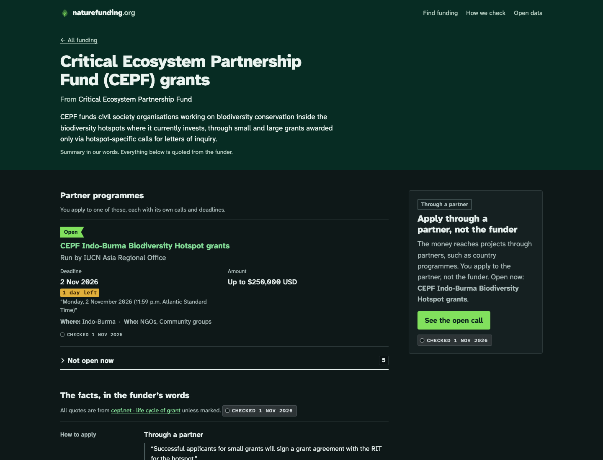

## Decision

The site looks like a restoration field kit. Each fact has a stamped aluminium "Checked 1 Nov 2026" tag with a punched hole. Status is a strip of flagging tape (lime open, blue rolling, orange upcoming, grey closed). The header band is dark spruce on a cool aluminium page, with matching dark mode. The type is Atkinson Hyperlegible Next for text and its Mono for stamped data.

## Why

The product's promise is "checked against the funder's page", so the checked date is the signature element instead of decoration. Atkinson Hyperlegible was designed for low-vision and second-language readers. Its slashed zero has no alternate, and the critic disliked it in amounts; I kept it for legibility. I passed on a generic green "nature" look and a card grid.

## Where

- src/styles/global.css
- .impeccable/surfaces/src-pages-index-astro.md

## Feedback

- 2026-11-01: Replaced by Bernat's choices (Restoration Scope palette, Geist Serif and Inter, shadcn, light only). The current look is in 2026-11-01-site-look-rs-palette.md.
