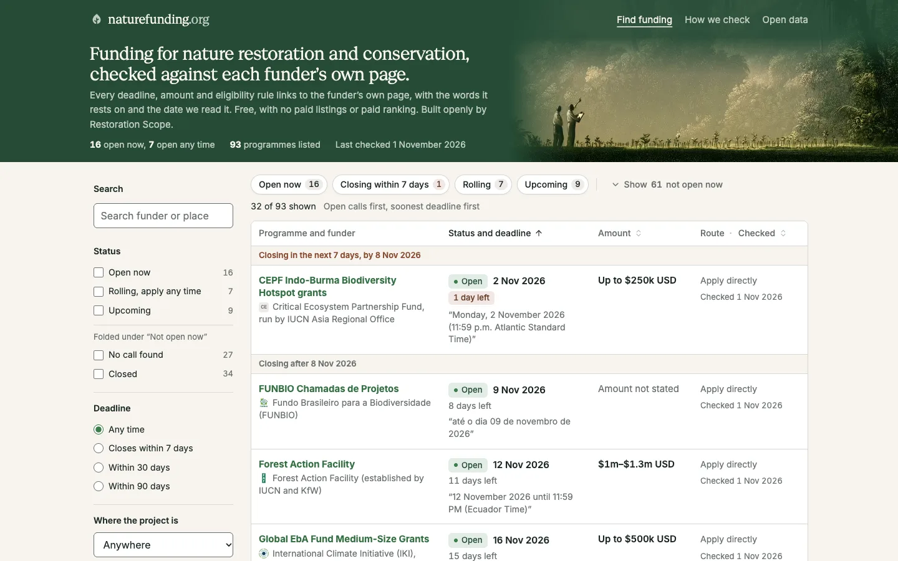
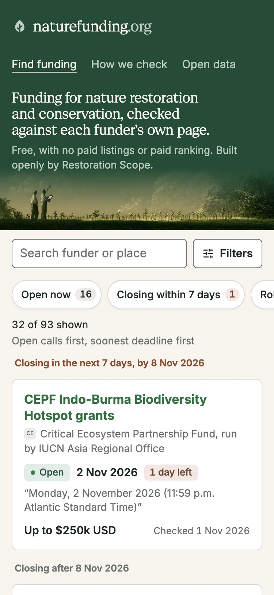
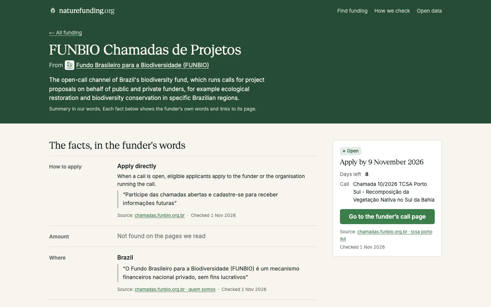
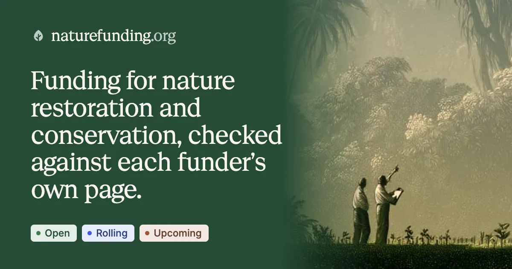

## Decision

The site uses Restoration Scope's look: beige paper, a brand-green header band, Geist Serif headings and Inter text, light only. A polish pass then made the details consistent: funder marks beside names, sans bold names in every list, calls as cards sorted by deadline, a tablet filter panel, 44px touch targets on phones, a 404 page with search, and a new leaf mark, favicon and share card.

## Why

Bernat chose the palette, fonts and shadcn; the field-kit look before it is retired. Lists use the sans so long funder titles read as data, while the serif stays for page and section headings. Every quote and checked date stays visible.

## Where

- src/styles/global.css, src/styles/finder.css
- src/pages/index.astro, src/pages/p/[id].astro, src/components/Listing.astro
- .impeccable/surfaces/src-pages-index-astro.md
